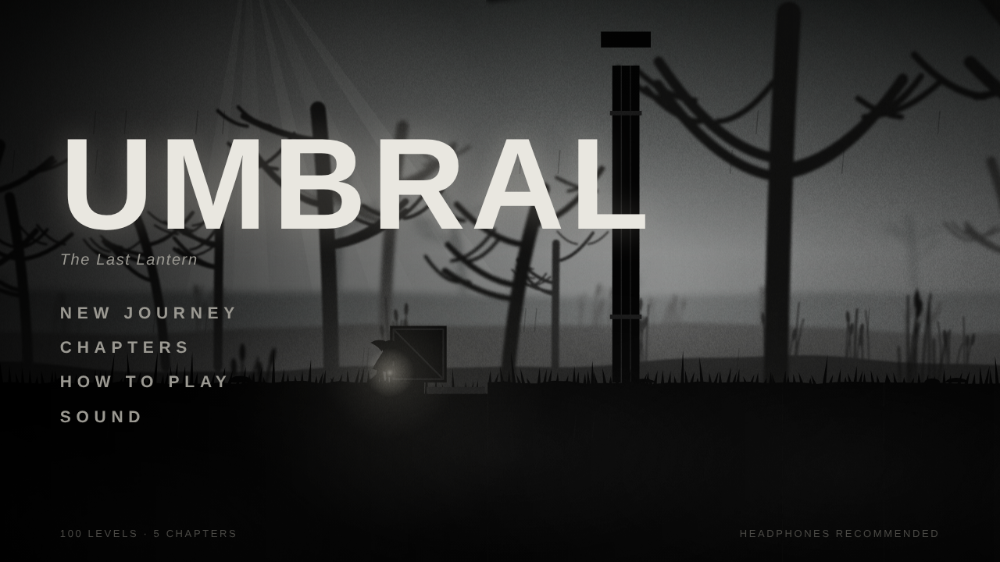
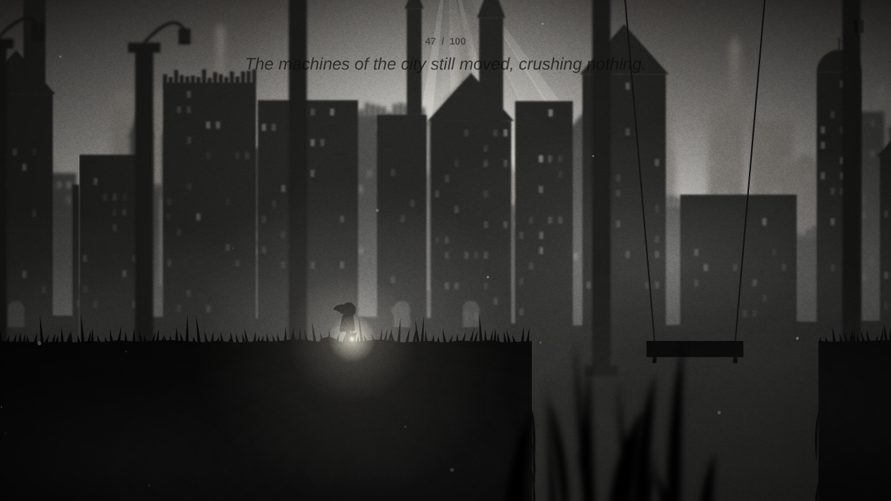
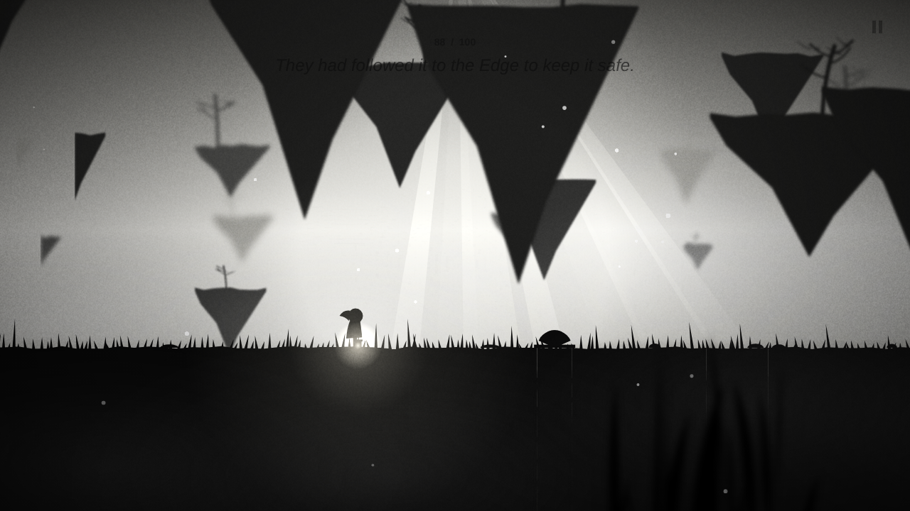

# UMBRAL — The Last Lantern

An atmospheric black-and-white puzzle platformer that runs in any browser. No installs, no downloads, no external assets: every tree, creature, sound and note of music is generated in code.

**Play now:** https://jainronakwork-jr.github.io/umbral-game/ (or open `index.html` locally).



| The Hollow City | The Pale Edge |
|---|---|
|  |  |

## The story

When the Great Lantern fell, the world forgot its colour. Wren wakes in a dark forest holding a lantern that will not go out. She carries its last ember across five chapters toward the edge of the world, and learns why it fell.

| Chapter | Name | Levels | New dangers |
|---|---|---|---|
| I | The Whispering Wood | 1–20 | Thorns, bear traps, falling stones, crates, levers |
| II | The Drowned Marsh | 21–40 | Black water, floating logs, Husks, pressure plates |
| III | The Hollow City | 41–60 | Crushers, hanging platforms, sealed gates |
| IV | The Iron Mill | 61–80 | Vertical and rolling saw blades |
| V | The Pale Edge | 81–100 | Everything, at full speed |

Every 20th level is a chase: the Dark pours in behind you and does not stop.

## Controls

| Action | Keyboard | Gamepad | Phone |
|---|---|---|---|
| Walk / push crates | ← → or A D | Left stick / D-pad | ◀ ▶ |
| Jump (hold for higher) | Space / W / ↑ | A | JUMP |
| Pull lever | E / ↓ | X | GRAB |
| Pause | Esc / P | Start | ❚❚ |

Progress, embers and sound settings save automatically in your browser.

## What's inside

- **100 levels** built from hand-tuned segments sized to the jump arc, so every one is solvable by construction.
- **Verified beatable:** an autopilot plays all 100 levels headlessly (`node tools/simtest.js`); every level is completed.
- **Rendering:** three-layer blurred parallax per chapter, volumetric light shafts, drifting fog, film grain, vignette, lantern bloom, particle deaths, screen shake.
- **Audio:** Web Audio synthesis only. Footsteps, splashes, gears, crushers, saws, a convolution reverb, chapter ambiences (birds, frogs, bells, distant machinery) and a slow generative score that ducks when you die.
- **Single file:** `index.html` is the whole game (about 110 KB).

## Project layout

```
index.html          the built, playable game
src/01_data.js      chapters and the 100 story lines
src/02_levels.js    level generator (segments, curated openers, chase levels)
src/03_world.js     deterministic physics and hazards
src/04_bot.js       autopilot used for playtesting and the trailer
src/05_audio.js     synthesized SFX, ambience and music
src/06_render.js    silhouette renderer and VFX
src/07_game.js      story flow, menus, input, saving, reel capture
src/shell.html      page shell and menus
tools/build.py      concatenates src/ into index.html
tools/simtest.js    plays every level and reports failures
tools/reel.js       renders the 9:16 trailer frame by frame
```

Rebuild after editing: `python3 tools/build.py`

## Trailer

`media/umbral-reel-4k.mp4` is a 2160×3840 (9:16) vertical trailer with sound and subtitles, captured from the real game.

## Credits

Original game, characters, art and music. Inspired by the moody silhouette platformers of the 2010s.
